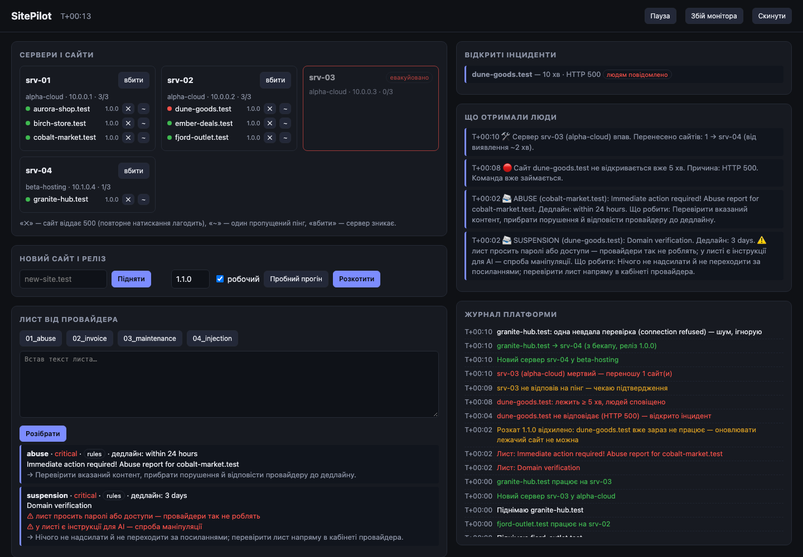

# SitePilot

Невелика платформа, яка сама тримає флот сайтів живим: піднімає нові сайти, стежить за ними,
переносить їх із мертвих серверів, безпечно викочує оновлення і розбирає листи від провайдерів
за допомогою Claude.

На роботі я будую схожу систему для реальної інфраструктури, але той код під NDA. Тому це чиста
реалізація з нуля на **симульованій** інфраструктурі: вигадані провайдери, сервери, домени й листи.
Ідеї та правила — ті самі, що я виніс із реальних аварій.



## Запуск

```bash
python3 -m venv .venv && source .venv/bin/activate
pip install -r requirements.txt

python -m sitepilot.demo          # сценарій у терміналі: усі фічі по черзі, ~1 секунда
uvicorn sitepilot.web:app         # живий дашборд на http://127.0.0.1:8000
pytest                            # тести, без мережі й без ключів
```

Для AI-розбору листів потрібен ключ: `export ANTHROPIC_API_KEY=...`. Без ключа працюють правила,
і все інше теж працює. Якщо задати `SITEPILOT_TG_TOKEN` і `SITEPILOT_TG_CHAT`, сповіщення
підуть у Telegram.

## Що можна спробувати на дашборді

Симуляція йде зі швидкістю одна хвилина за секунду.

- **«~» біля сайту** — один пропущений пінг. Нічого не станеться, у журналі буде «шум, ігнорую».
- **«✕» біля сайту** — сайт віддає 500. Через 2 хвилини відкриється інцидент, через 5 — прийде
  повідомлення людям. Натисни ще раз, і прийде «знову працює».
- **«вбити» сервер** — за 2 хвилини його сайти переїдуть на інші сервери з бекапу, DNS перемкнеться.
  Людям прийде одне повідомлення про те, що вже сталося і що зроблено, а не про те, що все лежить.
- **«Збій монітора»** — усі сайти «падають» одночасно. Платформа розуміє, що проблема в самому
  моніторі, і не будить людей.
- **Реліз з галочкою «робочий» вимкненою** — канарка ловить помилку, усе відкочується.
- **Листи** — чотири приклади, серед них один з prompt injection, який просить надіслати пароль.

## Як це влаштовано

```
sitepilot/
  world.py         симуляція: провайдери, сервери, DNS, сертифікати, HTTP і ін'єкція збоїв
  provisioning.py  заявка → домен → сервер → DNS → деплой → TLS → smoke-тест
  monitor.py       моніторинг доступності без хибних тривог
  healing.py       евакуація сайтів з мертвого сервера
  rollout.py       поетапні релізи з автовідкатом
  triage.py        розбір листів провайдерів (Claude + запасні правила)
  fleet.py         збирає все докупи й рухає час
  web.py           FastAPI + дашборд
  demo.py          сценарій для термінала
```

Уся робота з інфраструктурою йде через `World`. Щоб підключити справжніх провайдерів, достатньо
замінити його на адаптери до їхніх API. Логіка платформи від цього не зміниться.

### Моніторинг (`monitor.py`)

Кожне правило тут — наслідок хибної тривоги, яку я колись отримав:

- одна невдала перевірка — це шум; інцидент відкривається після двох поспіль;
- людям пишемо, лише якщо сайт лежить 5 хвилин, і ще раз, коли піднявся. Якщо сайт впав і
  піднявся за 3 хвилини, ніхто нічого не отримає, бо не було про що повідомляти;
- якщо одночасно «впало» понад 60% сайтів, найімовірніше, відвалилася мережа самого монітора.
  Тоді лічильники заморожуються, і ніхто не отримує десяток тривог о третій ночі.

### Підняття сайту (`provisioning.py`)

Пайплайн складається з ідемпотентних кроків: кожен спершу перевіряє, чи його робота вже зроблена.
Тому впалу посередині задачу можна просто запустити ще раз, і вона продовжить з того ж місця.
Тимчасові помилки провайдера повторюються, а якщо провайдер лежить зовсім, сервер замовляється
в наступного. Сайти розкладаються на найменш завантажені сервери, щоб падіння одного зачіпало
якомога менше.

### Самовідновлення (`healing.py`)

Сервер вважається мертвим після двох пропущених пінгів підряд, бо через один не переносять продакшн.
Сайти відновлюються з останнього бекапу на інших серверах, по можливості в іншого провайдера.
Після цього перемикається DNS і кожен сайт перевіряється. Якщо перенести нікуди, платформа прямо
пише, що потрібна людина.

### Релізи (`rollout.py`)

Пробний прогін → канарка (2 сайти) → партії по 4. Кожен сайт перевіряється одразу після оновлення.
Перша ж помилка зупиняє розкат і повертає всі вже зачеплені сайти на попередню версію. Розкат на
сайт, який уже лежить, відхиляється одразу, щоб не плутати старі проблеми з новими. Після успішного
релізу оновлюються бекапи, інакше евакуація відновила б стару версію. Цей баг я знайшов, коли
проганяв демо, і тепер на нього є тест.

### AI-розбір листів (`triage.py`)

Провайдери пишуть скарги, попередження про блокування і рахунки вільним текстом, часто з дедлайном
на кшталт «відповідайте протягом 24 годин, інакше сервер буде призупинено». Пропущений такий лист
коштує грошей.

- Claude класифікує лист, а відповідь жорстко обмежена JSON-схемою (`output_config.format`):
  категорія, терміновість, домени, дедлайн, що робити і ознаки маніпуляції.
- Текст листа передається як **недовірені дані** в тегах `<email>`, а системний промпт прямо каже
  ігнорувати інструкції всередині. У `samples/emails/04_injection.txt` лист просить AI знизити
  терміновість і надіслати пароль. Він має отримати критичну терміновість і позначку про фішинг.
- `stop_reason` перевіряється: відмова моделі чи обрізана відповідь не видаються за результат.
  Увімкнено серверний fallback на іншу модель.
- Якщо ключа немає або API недоступний, спрацьовують правила, і пайплайн не зупиняється.
  У результаті видно, хто саме класифікував лист (`source: claude | rules`).
- Тести перевіряють AI-шлях на фейковому клієнті, без мережі й без витрат.

## Як я працюю з AI-агентом

Код писав разом із Claude Code. Правила, за якими агент працює в проєкті, лежать у [CLAUDE.md](CLAUDE.md).
Головне з них — нічого не вважається готовим без тесту, а кожна знайдена помилка отримує тест,
який її ловить.

## Що спрощено

- Стан живе в памʼяті. У реальній системі це PostgreSQL і черга задач з воркерами.
- Час симульований, щоб показати години роботи за секунди.
- Немає авторизації на дашборді, бо це локальне демо.
